 

  

  
  
  

---

## `$ ls skills/`

**linguagens/**

  
  
  
  
  
  
  
  
  

**frameworks/**

  
  
  
  
  
  
  
  
  
  
  
  
  

**ferramentas/**

  
  
  
  
  
  
  

---

## `$ ./stats.sh`

  
  

  

---

## `$ git log --graph`

  

---

## `$ systemctl status`

  
  

<code>$ exit</code>

